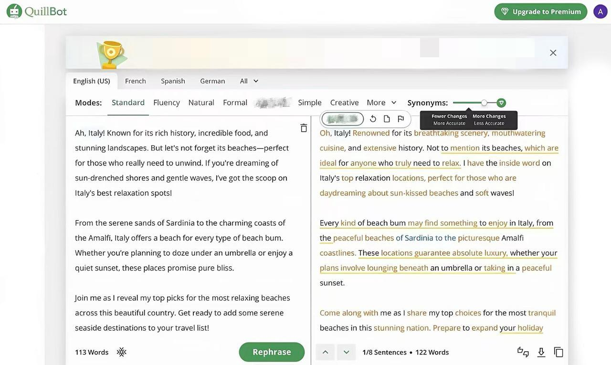

# Turntin新算法？2026英文降AI的真相！4 款英文降ai率工具测评

不少小伙伴写完英文稿件，做**英文降AI 率**自查时，会遇到文本 AI 相关指标不太理想的情况，明明整篇内容都是自己查阅资料整理撰写，只是行文用词偏规整，指标表现就不够理想。

这是因为新算法修改后，判定逻辑有所变化，我也尝试了多款**英文降AI 率工具**，踩了不少坑，慢慢摸索之后，我找到了合适的文稿优化思路，借助工具调整句式节奏，再通读全文手动微调，文稿的阅读质感会自然提升。

## 一、不用大幅重写！指标偏高不等于内容本身有问题

不少小伙伴看到自查指标不理想，第一反应就是大规模删改、重写全文，反复修改很容易改动核心观点、关键数据，耗费大量时间。

2026 年 Turnitin 更新了判定逻辑，系统不再只比对文字重复内容，会综合考量行文节奏、句式特点、表达习惯。

正式英文写作本身句式工整、逻辑清晰，文本特征容易被标记，很多原创稿件都会出现这类现象。

## 二、4 款热门英文文本优化工具实测对比

纯人工逐句打磨稿件耗时较长，如果临近提交节点，很难独立完成全文调整，如果搭配合适工具辅助润色，可以减轻修改压力，优化文稿自然度。 

我实测了当下热度较高的四款英文优化工具，覆盖**免费英文降AI 率工具**、文本润色、AI 指标自查等需求，帮大家横向参考，不用到处查找各类**英文英文降AI 率网站**挨个试错。

### 1、笔灵英文英文降AI

传送门： [https://u\.ibiling\.cn](https://ibiling.cn/paper-pass/english?from=githubywjiangai1009jw) 

这是我 2026 实测下来，对新版 Turnitin 表现很不错的**英文降AI 率工具，**短篇段落或是长篇英文稿件，都可以用来优化文本表达风格，在 Turnitin、ZeroGPT、Copyleaks、Originality 多个平台表现都很稳定。

它会通读全文理解上下文，重新组织句式语序，调整模板化的行文节奏，优化后的英文句子长短错落，读起来流畅自然，弱化文本自带的机器表达感，我用完之后的效果也很明显。

我很喜欢它的内容固定词锁定功能！可以提前锁定专业名词、实验数据、专有表述和核心观点，我用完发现的确很有用，我的核心专业内容不会被改变，保留了稿件本身的专业性。

排版方面实用性很强！支持 docx、txt 文档批量上传，原稿段落结构、表格、注释、原有格式全部原样保留，不需要额外花时间二次调整排版，这对我这种作业太多、总是赶ddl的人来说太友好了哈哈。

### 2、SpeedAI

SpeedAI 上手门槛很低，打开即可使用，自带简易英文 AI 自查功能，大家应该也可以搜到这款**英文降AI 率工具**。

我用下来发现，他比较适合临时处理小段文本润色，简单调整句式，局限性有些明显，改写深度偏浅，只能完成表层长句拆分、词汇替换，很难改善文稿深层模板化表达。

如果用它一次性处理长文本时改写质量会下降，更适合零散短句的微调哦。

### 3、降重鸟

降重鸟属于轻量化**英文英文降AI 率网站**，新用户注册有免费试用额度，主打英文润色，适合针对机器感偏重的段落做轻度提质。

我实测改写后的句子基本没有语法错误，语序调整、词汇替换这类基础操作都可以完成，不过它的改写力度有限，面对长复合从句很难优化到位，不容易调整模板化行文习惯。

还有就是它对复杂排版兼容性一般，稿件带有表格、多层级格式时，改写后排版容易错乱，需要手动复原，比较耗费精力。更适合搭配主力工具打磨局部文字细节。

### 4、QuillBot

QuillBot 知名度很高，支持多种文风切换，新用户有免费额度，可以用来短句润色、简单 AIGC 自查。

很多小伙伴查找**免费英文降AI 率工具**时都会刷到它，日常小段文字微调还算够用，但它不适合长篇稿件批量处理，大段内容改写之后排版容易错乱，段落错位，需要手动逐段调整。

它的改写多停留在词汇替换层面，底层句式改动很小，文本表达优化空间有限，更适合短篇文本微调。

## 三、聊聊文稿文风优化的实操思路

想要做好**英文降AI 率**相关的文本优化，并没有想象那么复杂，不必反复切换各类网站反复测试指标，也不用单纯依靠手动修改消耗大量精力。

只要用好工具，就可以省时省力，文稿流畅自然，核心观点不会跑偏。 最后提醒，工具只能作为写作辅助，优化完成务必通读全文，统一文风，核对所有关键信息哦。

